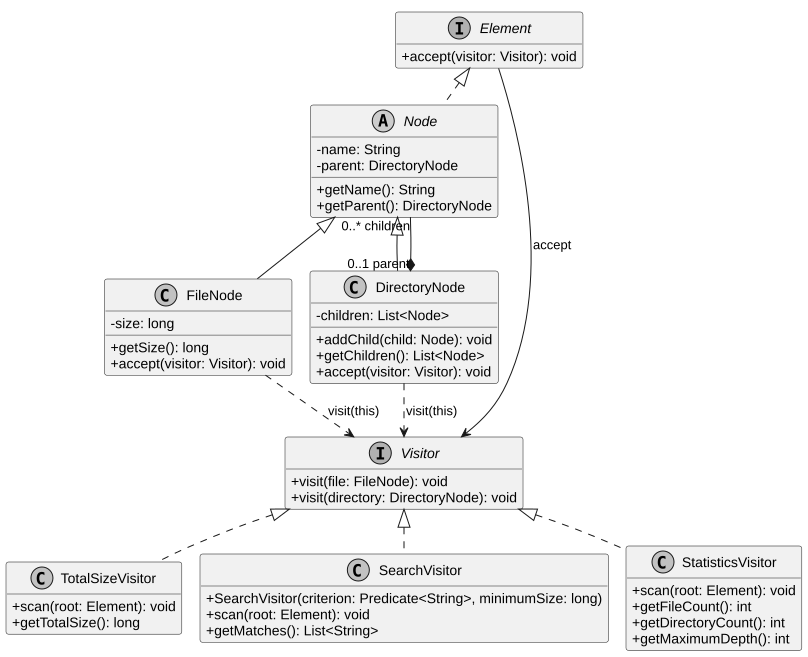
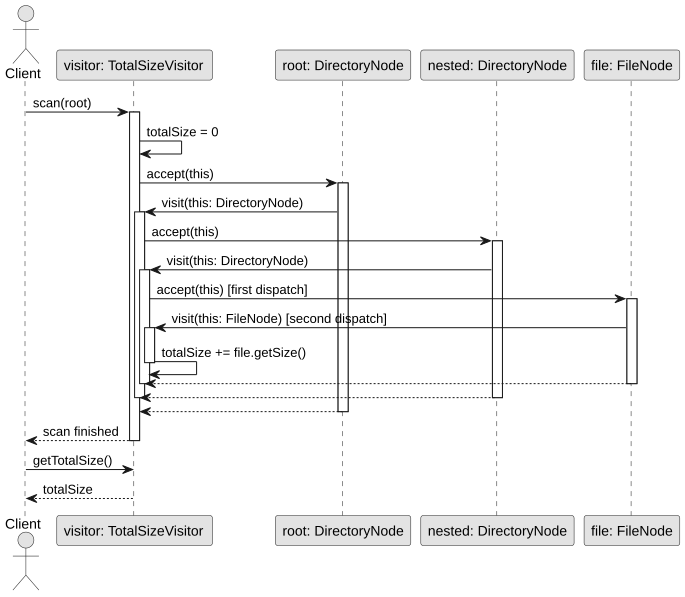

# Assignment 6 Visitor Pattern

Amirkhan Tulkibayev, group SE-2522

A small in-memory file system with three operations: total size, file search and statistics.

## Run

Requirements: JDK 17 and Maven 3.9+. Run from the project root:

```bash
mvn test
mvn compile exec:java
mvn compile exec:java -Dexec.args=".pdf 500"
```

Arguments are a case-sensitive filename substring and an inclusive minimum size in bytes.
Defaults: `.txt` and `120`. Any filename predicate can be passed to `SearchVisitor` in Java.

Default output:

```text
Root: workspace
Total size: 3368 bytes
Search: name contains '.txt', size >= 120
  documents/notes.txt
  notes.txt
Files: 5
Directories: 5
Maximum depth: 3
```

## Design

`FileNode` and `DirectoryNode` implement `Element` through `Node`.
`element.accept(visitor)` selects the concrete element's method; `visitor.visit(this)`
then calls the matching visitor overload. There are no element type checks.

Visitors own the recursive traversal. Each directory visit calls `accept(this)` once
for each child. Elements only dispatch, so children are not counted twice.
Call `scan(root)` to start or repeat an operation: it resets all previous results.
Direct `accept` calls are individual traversal steps, not fresh scans. Visitors are
for sequential use; read results only after a successful scan.

Search paths exclude the chosen directory root, use `/`, and are sorted with
Java's case-sensitive string order. A file used as the root has its own filename.
Depth counts edges from the chosen root (depth 0), including empty directories.
Names and sizes are immutable. `addChild` checks names, ownership and cycles before
changing the tree. Children and search results are immutable snapshots.
A size sum outside the `long` range throws `ArithmeticException`.

## Extension and tests

`StatisticsVisitor` was added after the two original visitors without changing
`FileNode`, `DirectoryNode` or `Visitor`. A new operation needs another visitor;
a new element type needs a new overload in `Visitor` and changes to every visitor.
Visitor-owned traversal keeps this example simple but repeats the child loop.

JUnit 5 classes: `DoubleDispatchTest`, `VisitorsTest`, `SearchVisitorTest`,
`TreeIntegrityTest`. They cover dispatch, nested and empty structures, search paths,
repeat scans, operation order and invalid mutations. The report records the actual run.

For the defense, trace `Main` -> `scan` -> `accept` -> `visit`, run `mvn test`,
then try the `.pdf 500` command: the result is `documents/plan.pdf`.
Edit `Main.createDemoTree()` to change the dataset.

## UML and report





Editable PlantUML sources and the DOCX/PDF report are in `docs/`.

Repository: https://github.com/hann-qaz/Assignment6_visitor_pattern
